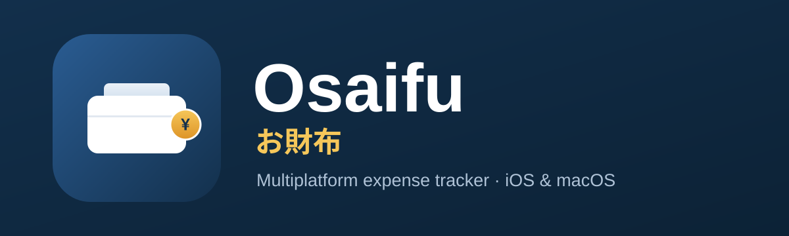

<p align="center">
  
</p>

<p align="center">
  <a href="https://github.com/YukiseKimi/osaifu-app/actions/workflows/tests.yml"></a>
  
  
  
</p>

# Osaifu （お財布）

**Osaifu** is a personal expense tracker for **iPhone, iPad, Apple Watch and Mac**. Log what
you spend, tag it with a common category, and see where your money goes — by month and over
time. Your data syncs across every one of them through **iCloud**.

> *Osaifu* (お財布) is Japanese for "wallet."

## The platforms

| Platform | Minimum | What it gives you |
| --- | --- | --- |
| **iPhone** | iOS 27 | The whole app: the three-tap pad, This Month, Budget, Expenses, History, Settings. A Home Screen widget for what the month has spent, and an App Intent for Siri, Shortcuts and the Action button. |
| **iPad** | iPadOS 27 | Everything the iPhone has, and a Dashboard the phone does not: a pie by category, a bar for each month, a bar for each year, and a tap on a month to move the pie. |
| **Apple Watch** | watchOS 27 | An expense in three turns of the Digital Crown, with no phone nearby. A complication and a Smart Stack card for what the month has left. |
| **Mac** | macOS 27 | The same app and the same Dashboard, on a window. |

Every one reads and writes one store, shared through iCloud.

## Features

- **Fast entry** — the pad takes an amount, one of the four categories you use most, and Save. The date, the note and another currency live behind **More**.
- **Siri and Shortcuts** — "Add an expense to Osaifu", with an amount and a category.
- **This Month** — a donut of spending by category, the running total, and a per-category breakdown.
- **Monthly budget** — one limit for the month, what is left of it, and what is left today. Optionally it carries over what last month did not spend.
- **Other currencies** — an expense keeps the currency you entered it in. Turn on FX Currency and give a rate, and it counts towards your totals and your budget. Nothing is fetched.
- **Expenses list** — every expense in a chronological list, grouped into month sections. Tap to edit, swipe to delete.
- **History** — a month-by-month stacked bar chart to compare months and categories.
- **iPad Dashboard** — three charts, and nothing else on the page.
- **Widgets** — what the month has spent on the Home Screen, and what it has left on the watch face.
- **iCloud sync** — SwiftData mirrored to CloudKit, with a badge that says, wherever you are, whether the data is going anywhere.
- **Sample data** — randomized expenses (or wipe everything) from Settings, for exploring the charts.

## Categories

Food &amp; Dining · Groceries · Transport · Housing · Utilities · Health · Entertainment ·
Shopping · Education · Travel · Other — each with its own icon and a consistent color across all charts.

## Tech stack

| Area | Technology |
| --- | --- |
| UI | SwiftUI, one codebase across the four platforms |
| Shared code | `OsaifuCore`, a local Swift package: the models, the money type, the migrations and the analytics |
| Charts | Swift Charts (`SectorMark` donut, `BarMark` bars, tap-to-select) |
| Persistence | SwiftData (`@Model`, `@Query`, `VersionedSchema`, `SchemaMigrationPlan`) |
| Sync | CloudKit, through SwiftData's iCloud mirroring, in one App Group |
| Widgets | WidgetKit, on the Home Screen and on the watch face |
| Voice | App Intents |
| Settings | A synced `Preferences` record, so a change on one device reaches the rest |
| Tests | Swift Testing — 92 headless tests, no simulator |

## Requirements

- Xcode with the **iOS 27 / iPadOS 27 / watchOS 27 / macOS 27** SDKs
- An Apple Developer account (required for the iCloud/CloudKit capability)

## Getting started

1. Open the project in Xcode and select the **Osaifu** scheme, or **OsaifuWatch** for the watch app.
2. In **Signing &amp; Capabilities**, choose your **Team** on each of the four targets.
3. Confirm the **iCloud** capability has **CloudKit** enabled with the container
   `iCloud.com.satsurakyno.MyApp`, and the **App Group** `group.com.satsurakyno.MyApp`
   (recreate both under your own team and bundle ID if needed).
4. Build and run on an iPhone, an iPad, an Apple Watch, or your Mac.
5. Open **Settings → Add Sample Data** to see the charts populated immediately.

To test sync, run the app on two devices or simulators signed into the **same iCloud account**
and add an expense on one.

`swift test --package-path OsaifuCore` runs the whole test suite in under a second, with no
simulator.

## Project structure

```
OsaifuCore/            # the shared Swift package: iOS, watchOS, macOS
├─ Sources/OsaifuCore/
│  ├─ Expense.swift        Budget.swift      Preferences.swift   ExchangeRate.swift
│  ├─ Money.swift          Currency.swift    AmountStep.swift    SpendRange.swift
│  ├─ Schema.swift         StoreSetup.swift  # versioned schema, migrations, the store
│  ├─ ExpenseAnalytics.swift  BudgetProgress.swift  SpendBuckets.swift  BudgetReader.swift
│  └─ SyncStatus.swift     SyncMonitor.swift SyncBadge.swift     WidgetRefresh.swift
└─ Tests/OsaifuCoreTests/  # 92 tests, headless

Osaifu/                # the app: iPhone, iPad, Mac
├─ ContentView.swift       # the app entry point and the tabs
├─ Intents/                # the Siri and Shortcuts intent
├─ Support/                # the theme and the home-currency environment
└─ Views/                  # the pad, This Month, Budget, Expenses, History,
                           # Settings, and the iPad Dashboard with its charts

OsaifuWidgets/         # the Home Screen widget
OsaifuWatch/           # the watch app
OsaifuWatchWidgets/    # the complication and the Smart Stack card
```

## Roadmap

- A limit for each category, beside the one for the month
- CSV export
- Narrowing the SwiftData queries with `#Predicate`, rather than filtering in memory

## License

Not yet licensed — all rights reserved for now. A license may be added later.
